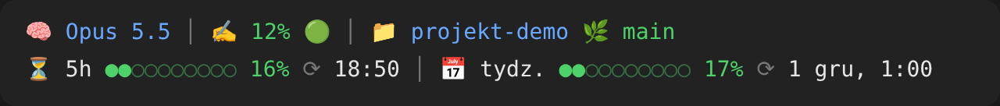
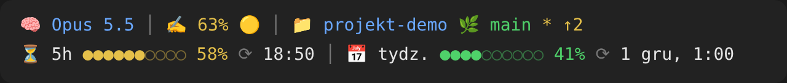
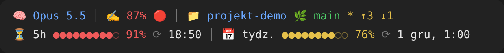

# linia-statusu

Mod Claude Code: dwa wiersze nad promptem z najważniejszym stanem sesji. Działa w terminalu i w aplikacji desktopowej; w VS Code i na mobile stan trafia do jednej linii statusu.



## Co pokazuje

**Pierwszy wiersz:** model, zajętość kontekstu z kropką stanu, katalog i gałąź git.

**Drugi wiersz:** limit 5-godzinny i tygodniowy, każdy z paskiem kropek, procentem i czasem resetu (⟳).

| Element | Znaczenie |
| --- | --- |
| 🧠 `Opus 5.5` | aktywny model |
| ✍️ `63%` | zajętość kontekstu |
| 🟢 / 🟡 / 🔴 / ⚪ | kontekst poniżej 50% / poniżej 80% / od 80% / brak odczytu |
| 📁 `projekt-demo` | katalog roboczy; długa nazwa jest ucinana wielokropkiem |
| 🌿 `main` | gałąź git |
| `*` | niezacommitowane zmiany |
| `↑2` / `↓1` | commity do wypchnięcia / do pobrania (wg ostatniego fetch) |
| ⏳ 5h, 📅 tydz. | limity użycia; kolor pasku wg progu: zielony <50%, żółty <80%, czerwony od 80% |

Kropka kontekstu jest widoczna od 0%. Od 80% (🔴) warto uruchomić `/compact`.

### Stany

Kontekst w połowie, zmiany w repo do wypchnięcia:



Kontekst i limity blisko progu:



Screeny są ilustracją na danych demonstracyjnych.

## Kompakcja

Gdy `CLAUDE.md` projektu nie ma sekcji „Compact instructions", mod dopisuje do kompakcji uniwersalne instrukcje: co zachować (cel, decyzje, poprawki użytkownika, gałąź, stan PR, zmienione pliki, padające testy). Własna sekcja w projekcie ma pierwszeństwo.

## Instalacja

Z promptu sesji w terminalu:

```
/plugin install linia-statusu --marketplace R4z3l/claude-statusline
```

Z powłoki:

```
claude plugin install linia-statusu --marketplace R4z3l/claude-statusline
```

W aplikacji desktopowej: + przy polu promptu, Plugins, Add marketplace z `R4z3l/claude-statusline`, potem Add plugin.

Repozytorium jest prywatne: wymaga poświadczeń git do github.com (`gh auth login`, potem `gh auth setup-git`).

Aktualizacja: `/plugin` → marketplace `claude-statusline` → update, potem nowa sesja.

## Rozwój

Testy (`tests/linia.test.tsx`) działają tylko w środowisku Claude Code: `claude plugin test .`. Walidacja: `claude plugin validate .`.
